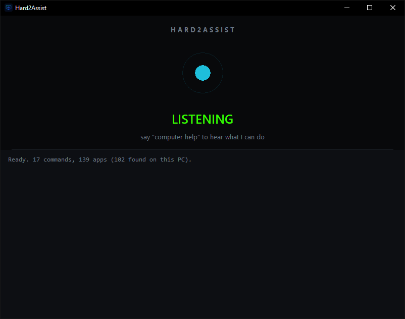
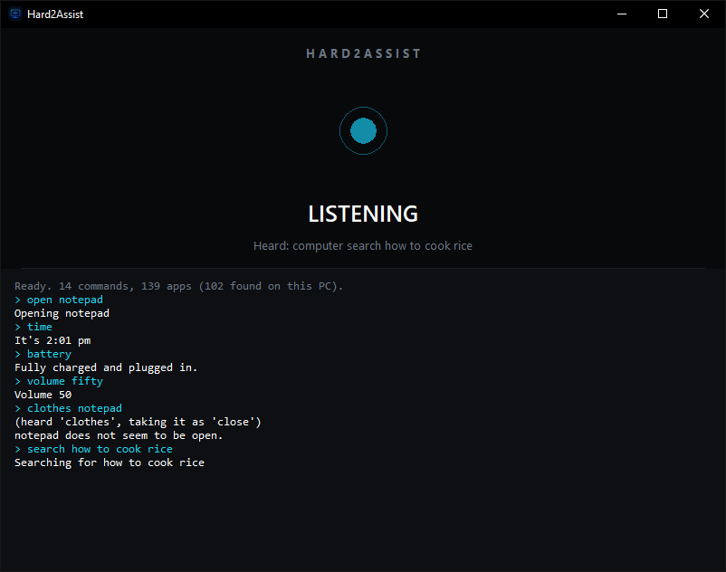
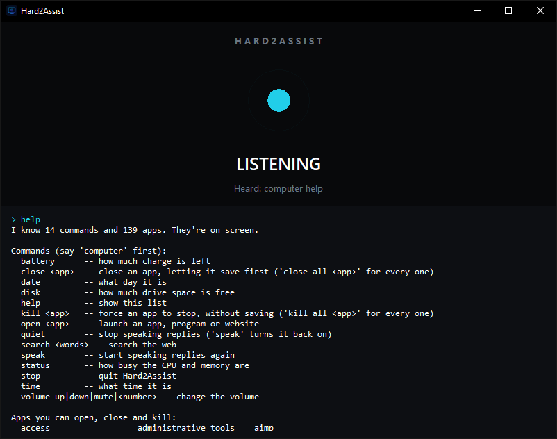

<div align="center">

# Hard2Assist

**WINDOWS VOICE ASSISTANT.**

Hard2Assist is a voice assistant for Windows. Say **"computer"** followed by a command
and it opens programs, folders and websites, types for you, closes and minimizes windows,
controls the volume, and answers questions about your PC — battery, time, disk space,
CPU load — out loud. It understands you on your own PC, so it works offline and nothing
you say leaves the machine. It installs from a single setup file and carries its own copy
of Python, so there is nothing else to install.

The first time you run it, it talks you through a short setup out loud — pick your own
wake word instead of "computer", and decide whether it listens all the time or only
while its window is in focus.



</div>

---

## Setup

### Option 1 — the installer (recommended)

Download `Hard2Assist-Setup.exe` from the
[latest release](https://github.com/S11mk3/Hard2Assist/releases/latest) (or build it, see
below) and run it. It asks where to install, whether you want a desktop shortcut, and
whether Hard2Assist should start with Windows. It does **not** ask for administrator
rights: by default it installs just for you, under `%LOCALAPPDATA%\Programs`.

All you need is 🎤 **a microphone**. Speech is recognised on your PC by
[Moonshine](https://github.com/moonshine-ai/moonshine), a speech model that ships inside
the installer, so no internet connection is needed.

> **"Windows protected your PC"?** Click **More info → Run anyway**. Hard2Assist is not
> signed with a code-signing certificate, and Windows shows that warning for every
> unsigned program from a publisher it has not seen before. The certificates that remove
> it are a paid yearly subscription from a certificate authority.

### Option 2 — run from source

Needs **Python 3.13** on Windows 10 or 11.

```
pip install -r requirements.txt
python build.py --fetch-model     # once: the 139 MB speech model, into models\
python hard2assist.py             # the window
python hard2assist.py --console   # the same thing in a terminal, no window
```

Without the model it still runs, using Google's speech service over the internet instead,
and says so when it starts.

### Tests

```
pip install -r requirements-dev.txt
python -m pytest           # tests
python -m ruff check .     # lint
```

The tests check how speech becomes commands: the wake word, which command a sentence
asks for and with what argument, misheard words, spoken numbers, keys and punctuation,
the answers to the setup questions, and the saved settings and apps. They need no
microphone, no speech model and leave your own files alone. Both run on every push to
`master` (GitHub Actions, [`ci.yml`](.github/workflows/ci.yml)).

### Building it yourself

```
pip install -r requirements-build.txt
python build.py
```

That writes `dist\Hard2Assist\` — the app, with Python and the speech model beside it
(the model is downloaded into `models\` the first time). Open the
`Hard2Assist.exe` inside and say `computer help`: seeing every command listed is how you
know the build is complete, because a build missing a piece still starts and looks fine.

To wrap that folder into the installer, install
[Inno Setup](https://jrsoftware.org/isdl.php) (free, no account needed) and run:

```
python build.py --installer
```

which writes `installer\Hard2Assist-Setup.exe`, the single file to hand to anyone else.
The version comes from `version.py`, the only place to change it for a release.

<details>
<summary>Why a folder rather than one big .exe?</summary>

It used to be a single 57 MB `.exe`. PyInstaller builds those by appending a compressed
archive to a small launcher, so every single launch unpacked ~67 MB into `%TEMP%` before
the window could appear — about **4 seconds, every time**. Antivirus heuristics are also
suspicious of that shape, because writing executables into a temp folder and running them
is what droppers do.

Shipping a plain folder removes the unpacking step entirely (**under a second to the
window**), and the installer keeps the download a single file.

</details>

---

## How to use

Start Hard2Assist, wait for **LISTENING**, then say **"computer"** followed by what
you want:

| Say this | And it |
| --- | --- |
| `computer open notepad` | launches an app, a program, or a website |
| `computer open obs studio` | opens anything in your Start Menu or from the Microsoft Store — no setup |
| `computer open youtube` | opens the site in your browser |
| `computer open documents` | opens a folder — `downloads`, `pictures`, `desktop`… |
| `computer focus notepad` | brings it to the front, even if it was minimised |
| `computer minimize it` | **"it" means whatever you last named** |
| `computer minimize everything` | clears the screen. `show desktop` works too |
| `computer fullscreen notepad` | fills the screen with it. "full screen" works too |
| `computer shrink notepad` | puts it back to its normal size |
| `computer close notepad` | closes it, letting it save first |
| `computer close youtube` | closes just that tab, not the whole browser |
| `computer kill notepad` | forces it to stop |
| `computer type hello there` | types it into the app you last named |
| `computer press enter` | also `tab`, `escape`, `save`, `copy`, `paste`, `undo`, `F5`… |
| `computer press control shift t` | any key combination, held keys first |
| `computer new tab` | also `close tab` |
| `computer dictate` | types everything you say, until you say **computer stop dictating** |
| `computer what's open` | lists the windows on screen |
| `computer time` | 🔊 *"It's 8:02 pm"* |
| `computer date` | 🔊 *"It's Friday, August 8"* |
| `computer battery` | 🔊 *"82 percent, charging"* |
| `computer status` | 🔊 *"CPU 12 percent, memory 46 percent"* |
| `computer disk` | 🔊 *"C drive has 58 gigabytes free"* |
| `computer volume 50` | sets it to exactly 50%. "fifty" works too |
| `computer volume up` | louder by ten, and says where it ended up. `up by 20`, `down` and `mute` too |
| `computer screenshot` | saves a picture of the screen to Pictures, under Screenshots |
| `computer search how to cook rice` | opens the results in your browser |
| `computer search youtube for cats` | searches one site — also wikipedia, github, reddit, maps, amazon |
| `computer remember music player` | opens a file picker once — then `open music player` just works |
| `computer remember website music` | saves the address you copied in the browser, under that name |
| `computer forget music` | removes a program or website you taught it |
| `computer introduce` | 🔊 *"I'm Hard2Assist, a voice assistant for Windows, made by Andrija Simic…"*. `who are you` works too |
| `computer help` | lists every command on screen |
| `computer help apps` | lists everything it can open — programs, folders, websites |
| `computer help open` | explains one command in full. Any command name works |
| `computer quiet` | stops speaking replies. `speak` turns it back on; `speak faster` / `speak slower` |
| `computer customize` | change the wake word and how it listens |
| `computer stop` | quits |
| `computer open notepad and type hello` | several commands in one sentence |

Every command confirms what it did, and the log keeps the whole conversation:

<div align="center">

</div>

A few things worth knowing while you use it:

- **It sets itself up by talking to you.** On the very first run it asks two questions
  out loud, explains each one, reads your answer back, and waits for you to confirm it
  before saving. Say `computer customize` to go through it again, and say **keep** to
  leave any single answer alone. If it mishears three times it keeps the current value,
  says so, and moves on — a bad microphone costs you a setting, never the whole app.

  - **Your wake word.** Any single word of three letters or more that isn't one of its
    commands. Pick `jarvis` and it answers to `jarvis open notepad`, and to nothing else.
    "Let's use jarvis" works as an answer too.
  - **When it listens.** *Always* is hands free but the microphone is live whenever the
    app is running. *Only when in focus* switches the microphone **off** whenever another
    window is in front — Windows' microphone icon goes away — and back on when you click
    its window. The window says **NOT IN FOCUS** meanwhile, so it never looks broken.

- **Say just the wake word and it asks "Yes?"**, then takes the next thing you say as the
  command — no need to say it all in one breath.

- **Push to talk.** Press **Ctrl+Alt+Space** anywhere and it listens for one command, no
  wake word needed — even under *only when in focus*, with its window in the background.

- **You can type instead.** The box at the bottom of the window takes any command, with or
  without the wake word: `open notepad`, `what time is it`. Handy in a loud room, and it
  works with no microphone at all.

- **It remembers what you just named.** Say `computer open notepad` and then **"it"**,
  **"that"** or **"this"** means notepad until you name something else:

  ```
  computer open notepad
  computer type hello there
  computer minimize it
  computer close it
  ```

  Only the app is remembered, never a particular window — the commands still go and find
  the windows each time, exactly as they do when you say the name in full. Say
  `computer what's open` to see what is around to be named.

- **Several commands at once.** Join them with **and** or **then**: `computer open notepad
  and type hello`, `computer volume up then what time is it`. Each waits for the one
  before — the next command runs once the app it opened is on screen. Text you are typing
  or searching for is never split: `computer type salt and pepper` types all of it.

- **It can type for you.** `computer type <anything>` types it into the app you last
  named, bringing that app to the front if you have clicked into another window since —
  so `type` follows `open` the way the two sound when you say them. `press` and `dictate`
  work the same way. Until you name an app, they use the window in front.

  Punctuation can be said out loud: **new line**, **comma**, **period**, **question
  mark**. `computer type hello there comma how are you question mark` types *"Hello
  there, how are you?"*. The speech model adds punctuation of its own too; a spoken mark
  replaces it rather than doubling up.

  For more than a sentence, say `computer dictate` and just talk — every sentence is typed
  as you say it, with no wake word needed, until you say `computer stop dictating`. Every
  sentence goes into the app you named, even if you click elsewhere while talking.

- **It talks back.** Short answers are spoken; long lists are written to the window
  instead, so `computer help` says *"I know 27 commands and 131 apps, they're on screen"*
  rather than reading all of them out. Say `computer quiet` to silence it and
  `computer speak` to turn the voice back on.

- **It knows what is on your PC.** Every shortcut in your Start Menu, and every app from
  the Microsoft Store, is found at startup — over a hundred programs on a typical machine
  — so `computer open obs studio` or `computer open sticky notes` works without any
  configuration. Install something new and it works next time you start. Say
  `computer help` to see the full list:

  <div align="center">
  
  </div>

- **If it does not know something, it asks.** Say `computer open photoshop` for a
  program it has not found and it asks whether you want to point it at the program; say
  **yes** and a file picker opens. Click the program once and it is remembered forever, in
  `%APPDATA%\Hard2Assist\my-apps.json`. (You cannot dictate `C:\Program Files\...` out
  loud, so it does not ask you to.)

  You can also teach it up front: `computer remember music player` opens the same
  picker straight away, and `computer remember website music` saves whatever address you
  last copied in the browser. `computer forget music` takes either back out.

- **It expects to be misheard.** Speech recognition can hear **"clothes"** when you say
  **"close"**. Commands carry a list of what they actually get misheard as, and
  anything still unmatched goes through fuzzy matching. It always tells you when it
  corrects something — you can see it in the screenshot above:

  ```
  > clothes notepad
  (heard 'clothes', taking it as 'close')
  ```

  Plain synonyms — `quit` for `stop`, `show` for `focus` — just work, without a note.
  Guessing is never used for `kill`, `close` or `stop`: a mishearing must not destroy
  anything or quit the app, so those need their own words.

  App names get the same treatment: `computer open ccleaner` finds *CCleaner 7*, and
  `computer open obs` finds *OBS Studio*.

  So does the wake word. An accent or a clipped start turns "computer" into
  *"commuter"*, *"compute her"* or *"puter"*, and in a noisy room the recogniser often
  writes out a sentence of background before it. A near miss counts, so does
  **"hey computer"** or **"okay computer"**, and so does the wake word starting any
  sentence in what was heard, not just the first. Those are guesses, so they only
  count when a command comes straight after: *"commuter trains are late"* and *"I
  bought a computer yesterday"* still do nothing, and neither does *"computers"*,
  which is a different word. When something is heard without the wake word the
  window says so — `Heard "…" (no wake word)` — so you can tell a misheard wake
  word from a microphone that heard nothing.

- **`close` closes the right window.** `close cmd` closes the **most recently opened**
  cmd, so opening one by voice and closing it leaves the one you were already working
  in alone. `close all cmd` closes every one. A website closes only its tab:
  `close youtube` brings the browser window showing it forward and closes that tab.
  `kill` refuses websites, since it would take the whole browser down.

- **It does not hear itself.** While it speaks, the microphone is off. Otherwise it
  would hear *"Closing one window"*, pick the word *close* out of it, and set off again.

- **It keeps up with the room.** How loud counts as speech is measured from the room
  when it starts, and then re-measured all the time from the last ten seconds, so a
  television turned up, a fan switched off, or somebody talking while it started does
  not leave it deaf to a quieter voice for the rest of the session. Bursts and your own
  commands are ignored in that measurement; only the room's steady level counts.

- **It survives a microphone being unplugged.** It says so once, keeps checking, and
  picks the microphone up again when it comes back — or a new one, if you plug one in.

- **It listens on your PC.** Speech is turned into text by
  [Moonshine](https://github.com/moonshine-ai/moonshine) small, a 139 MB speech model
  that runs on the CPU: about 0.7 seconds per command even on a 2014 laptop, with
  about 200 MB of memory. It detects speech before transcribing, so coughs, typing and
  background noise are dropped rather than turned into words. If the model cannot load,
  it falls back to Google's free speech service, which needs the internet, and says so
  in the window.

### Settings

Your answers live in `%APPDATA%\Hard2Assist\settings.json`. Delete that file to be asked
again from scratch. A few settings are only in the file:

| Setting | Values |
| --- | --- |
| `"recognizer"` | `"auto"` — Moonshine, or Google when Moonshine is unavailable (the default)<br>`"local"` — Moonshine only, nothing ever goes online<br>`"google"` — Google only |
| `"voice"` | part of the name of a Windows voice, such as `"zira"`. Empty for the default voice |
| `"voice_rate"` | how fast it talks, from `-10` to `10`. `speak faster` and `speak slower` change it |
| `"hotkey"` | the push-to-talk key, such as `"ctrl+alt+space"` or `"ctrl+shift+h"`. Empty turns it off |

Everything it writes and says, and any error, goes to `%APPDATA%\Hard2Assist\log.txt` —
the first thing to look at when something goes wrong.

---

## Adding your own

### A command

Drop a file in any folder under `commands/`:

```python
from output import say

NAME = "greet"
TAKES_ARG = False
ALIASES = ("great",)               # what the recogniser hears instead
SYNONYMS = ("greeting",)           # other words that mean the same
HELP = "greet -- say hello"

ABOUT = """\
Greet says hello back.
Shown by "{prefix} help greet", where the first sentence is spoken and the
rest is only written.\
"""

def run():
    say("Hello!")
```

It is picked up on the next start and `help` lists it automatically. Use
`TAKES_ARG = True` and `run(argument)` to receive the rest of the sentence,
and add `ARG_OPTIONAL = True` if it should also run with nothing after it.
`PHRASES` adds whole sentences that reach the command without naming it, and
`EXACT_ONLY = True` keeps a command that destroys something from ever being reached
by a guess. The full list is at the top of `registry.py`.

`ABOUT` is optional — without one, `computer help greet` still answers, using
the `HELP` line and the example. With one, that page is as long as the command
deserves. `{prefix}` inside it becomes whatever the wake word currently is, so
an explanation never tells someone to say a word that no longer works.

**`say()` writes and speaks. `warn()` does the same, highlighted, for something that
did not work. `detail()` only writes.** Speaking is the default so a new command is
never accidentally silent — reach for `detail()` only when the output is a list or a
long explanation nobody would want read aloud.

This works with the installed app too. Put the file in a `commands\<group>\` folder in
either of these, then restart — no rebuild needed:

- `%APPDATA%\Hard2Assist\commands\` — always works, whatever folder you installed to
- next to `Hard2Assist.exe` — only if you can write to the install folder, which you
  cannot under `Program Files`

Neither is loaded while Hard2Assist runs as administrator: anyone able to drop a file
there would otherwise have it run with administrator rights.

### An app, a website or a folder

One line in `apps/system.py` or `apps/websites.py`:

```python
App("notepad", "notepad", "Notepad")
#    name      launch      window title

site("youtube", "https://www.youtube.com")
```

`launch` goes to the Windows shell, so an exe, a `.msc` console, a `ms-settings:` URI,
a `.lnk` shortcut, a folder path or a URL all work — which is why websites and folders
need no command of their own and go through the same `open` as everything else.
`apps/folders.py` adds the standard folders that way, asking Windows where each one
really is rather than assuming (Downloads is on a different drive on plenty of PCs).

---

## Project layout

```
hard2assist.py      entry point -- the window, or --console
gui.py              the window
theme.py            colours and fonts, all in one place
listener.py         the microphone loop
recognizer.py       what was said: Moonshine on this PC, or Google as the fallback
speech.py           the voice
settings.py         what the user chose, saved between runs
storage.py          where things live, and saving JSON safely
wizard.py           the spoken setup conversation
registry.py         finds commands, works out which one you meant
session.py          what you last named, so the next command can say "it"
output.py           say(), warn() and detail(), and the log file
spoken.py           turning what was heard into what gets typed
ask.py              asking you for a file mid-command
win.py              the only Windows API code
audio.py            reading and setting the exact volume
version.py          the version number and author, for the build and `introduce`
build.py            builds the app folder, and the installer
installer.iss       the installer, for Inno Setup

commands/
  TextCommands/     answers      help introduce time date battery status disk windows
  AppCommands/      acting       open focus minimize fullscreen shrink close kill remember forget
  Typing/           the keyboard type press dictate
  Controls/         the PC       volume quiet speak stop customize screenshot
  Web/              online       search

apps/
  app.py            what an app is -- name, how to launch it, how to find its window
  system.py         built into Windows
  folders.py        Documents, Downloads and the rest, wherever Windows put them
  installed.py      found in your Start Menu and the Store, plus ones you picked
  websites.py       sites
  itself.py         the app itself, so "focus yourself" has something to find

models/             the speech model; not in git, fetched by build.py --fetch-model

tests/              how speech becomes commands; run with pytest
requirements*.txt   running from source, building, and testing
pyproject.toml      settings for pytest and ruff
```

---

## Known limits

- **Elevated apps.** Device Manager, Services, Registry Editor and friends can run as
  administrator. Windows will not let a normal program send window messages to one, so
  `close` reports that it was refused rather than pretending. `kill` usually still
  works. Run Hard2Assist as administrator to `close` them. The same rule blocks `type`
  and `press` from reaching an elevated window, and they say so rather than typing
  into nothing.
- **`dictate` listens without the wake word.** That is the point of it — you cannot say
  "computer" before every sentence of a paragraph — but it does mean that while it runs,
  everything you say is typed. The wake word comes back for the one sentence that ends it:
  say **computer stop dictating**, or stay quiet and it stops by itself. A bare "stop" is
  deliberately not enough — it ends ordinary sentences too ("the bus came to a stop"), and
  a dictation that quits halfway through a paragraph is worse than one that needs three
  words to leave. Said on the end of a sentence it still works, and the sentence is typed
  first. It also keeps listening under *only when in focus*, because the app you are
  dictating into is by then the one in front.
- **Focus can be refused.** Windows does not let a background program take the
  foreground in every situation. When it refuses, `focus` says so rather than
  pretending, and the app's taskbar button flashes instead.
- **Closing Start Menu programs is best-effort.** They are found by window title, which
  does not always match the shortcut name. Programs you pick yourself are matched by
  their process and close reliably. Opening always works.
- **Websites are found by their tab.** `close youtube` finds a browser window whose tab in
  front is YouTube; a YouTube tab hidden behind another tab cannot be seen from outside
  the browser.
- **Loud rooms.** Hearing starts on loudness, so it cannot tell your voice from people
  talking or a television near the microphone. In a loud room it still hears you, but
  a recording can run on with the background in it, and a quiet voice from across the
  room can be lost under it. Speak within arm's length of the microphone there, and
  a headset works best — or use push to talk, or type.
- **Spoken punctuation can be misheard.** The speech model sometimes hears "comma" as
  "corner" or "question mark" as "question number", and those are typed as words. It
  punctuates sentences by itself from how you say them, so the words are rarely needed.
- **English only.** The speech model is Moonshine's English one, so commands have to be
  spoken in English. The voice that answers is whichever Windows voice is installed.
- **The installer is bigger than it used to be.** The speech model is bundled so the app
  works offline from the first launch, which adds about 139 MB before compression.

---

## License

Hard2Assist is proprietary software. You may install and use the official release on your
own computers, and add your own command files to your installation for your personal use.
Copying, modifying or redistributing it, or its source code, needs the author's written
permission. See [LICENSE](LICENSE).

It is built on open-source components that keep their own licenses: Python, the
[Moonshine](https://github.com/moonshine-ai/moonshine) speech model, and the libraries in
`requirements.txt`.
