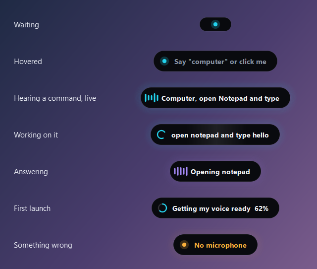
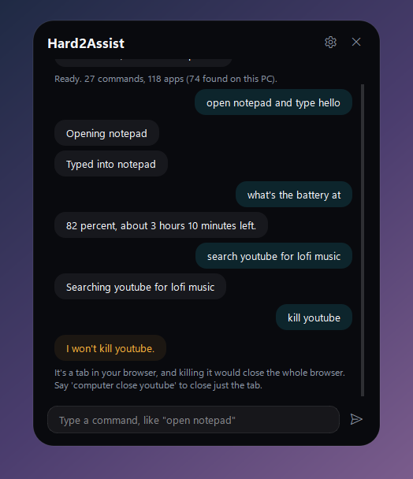
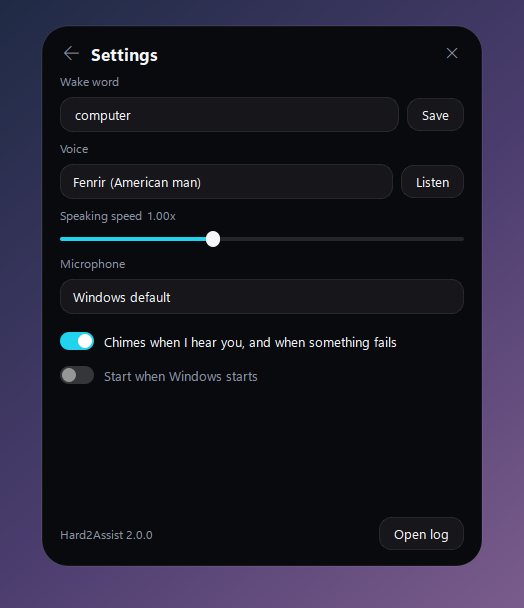

<div align="center">

# Hard2Assist

**A VOICE ASSISTANT THAT LIVES AT THE TOP OF YOUR SCREEN.**

Hard2Assist sits at the top of your screen as a small pill, like the music island on a phone.
Say **"computer"** followed by a command and it opens programs, folders and websites, types for
you, closes and minimizes windows, controls the volume, and answers questions about your PC —
battery, time, disk space, CPU load — out loud, in a natural voice. It hears you and talks to you
entirely on your own PC: after a one-time download, it works offline and nothing you say ever
leaves the machine.



</div>

---

## Setup

### Option 1 — the installer (recommended)

Download `Hard2Assist-Setup.exe` from the
[latest release](https://github.com/S11mk3/Hard2Assist/releases/latest) (or build it, see
below) and run it. It asks where to install, whether you want a desktop shortcut, and whether
Hard2Assist should start with Windows. It does **not** ask for administrator rights: by default
it installs just for you, under `%LOCALAPPDATA%\Programs`.

All you need is 🎤 **a microphone**, and an internet connection **the first time it starts**: it
downloads its hearing and its voice (about 360 MB, once), with the progress shown in the dock.
After that it never needs the internet again.

> **"Windows protected your PC"?** Click **More info → Run anyway**. Hard2Assist is not
> signed with a code-signing certificate, and Windows shows that warning for every
> unsigned program from a publisher it has not seen before. The certificates that remove
> it are a paid yearly subscription from a certificate authority.

### Option 2 — run from source

Needs **Python 3.13** on Windows 10 or 11.

```
pip install -r requirements.txt
python hard2assist.py             # the dock
python hard2assist.py --console   # the same thing in a terminal
```

The first run downloads the speech model and voice into `models\`.

> Using the Microsoft Store's Python? Windows gives it a microphone permission of its own: allow
> **Python** under Settings → Privacy & security → Microphone, or it hears nothing.

### Tests

```
pip install -r requirements-dev.txt
python -m pytest           # tests
python -m ruff check .     # lint
```

The tests check how speech becomes commands — the wake word, which command a sentence asks for
and with what argument, misheard words, spoken numbers, keys and punctuation — plus the setup
answers, the saved settings and apps, the listening loop, the download, and the dock itself
(drawn offscreen). They need no microphone and leave your own files alone. Both run on every push
to `master` (GitHub Actions, [`ci.yml`](.github/workflows/ci.yml)).

### Building it yourself

```
pip install -r requirements-build.txt
python build.py                   # dist\Hard2Assist\ -- the app
python build.py --installer       # ...and installer\Hard2Assist-Setup.exe
```

The installer needs [Inno Setup](https://jrsoftware.org/isdl.php) (free, no account). The version
comes from `version.py`, the only place to change it for a release. The speech model and voice
are not bundled: the app downloads them on first launch, which keeps the installer small.

---

## How to use

The pill at the top of the screen is Hard2Assist:

| It shows | When |
| --- | --- |
| a small breathing dot | it's waiting for you |
| a **live waveform and your words** | you're saying a command — the text appears as you speak |
| a spinner with a shimmer | it's working on it |
| violet voice bars and the reply | it's answering |
| an amber dot | something is wrong, such as no microphone |

**Click** the pill to open the conversation, with a box to **type** commands into and the
settings behind the gear. **Click it while it's talking** to stop it. **Right-click** for the
menu, including Quit. **Esc** or clicking anywhere else closes it again. It never takes the
keyboard away from what you're doing, and it gets out of the way while a game or video is
fullscreen.

<div align="center">

</div>

Say **"computer"** followed by what you want:

| Say this | And it |
| --- | --- |
| `computer open notepad` | launches an app, a program, or a website |
| `computer open obs studio` | opens anything in your Start Menu or from the Microsoft Store — no setup |
| `computer open youtube` | opens the site in your browser |
| `computer open documents` | opens a folder — `downloads`, `pictures`, `desktop`… |
| `computer focus notepad` | brings it to the front, even if it was minimised |
| `computer minimize it` | **"it" means whatever you last named** |
| `computer minimize everything` | clears the screen. `show desktop` works too |
| `computer fullscreen notepad` | fills the screen with it. "full screen" works too |
| `computer shrink notepad` | puts it back to its normal size |
| `computer close notepad` | closes it, letting it save first |
| `computer close youtube` | closes just that tab, not the whole browser |
| `computer kill notepad` | forces it to stop |
| `computer type hello there` | types it into the app you last named |
| `computer press enter` | also `tab`, `escape`, `save`, `copy`, `paste`, `undo`, `F5`… |
| `computer press control shift t` | any key combination, held keys first |
| `computer new tab` | also `close tab` |
| `computer dictate` | types everything you say, until you say **computer stop dictating** |
| `computer what's open` | lists the windows on screen |
| `computer time` | 🔊 *"It's 8:02 pm"* |
| `computer date` | 🔊 *"It's Friday, August 8"* |
| `computer battery` | 🔊 *"82 percent, charging"* |
| `computer status` | 🔊 *"CPU 12 percent, memory 46 percent"* |
| `computer disk` | 🔊 *"C drive has 58 gigabytes free"* |
| `computer volume 50` | sets it to exactly 50%. "fifty" works too |
| `computer volume up` | louder by ten, and says where it ended up. `up by 20`, `down` and `mute` too |
| `computer screenshot` | saves a picture of the screen to Pictures, under Screenshots |
| `computer search how to cook rice` | opens the results in your browser |
| `computer search youtube for cats` | searches one site — also wikipedia, github, reddit, maps, amazon |
| `computer remember music player` | opens a file picker once — then `open music player` just works |
| `computer remember website music` | saves the address you copied in the browser, under that name |
| `computer forget music` | removes a program or website you taught it |
| `computer introduce` | 🔊 *"I'm Hard2Assist, a voice assistant for Windows, made by Andrija Simic…"*. `who are you` works too |
| `computer help` | lists every command |
| `computer help apps` | lists everything it can open — programs, folders, websites |
| `computer help open` | explains one command in full. Any command name works |
| `computer quiet` | stops speaking replies. `speak` turns it back on; `speak faster` / `speak slower` |
| `computer customize` | change the wake word |
| `computer stop` | quits |
| `computer open notepad and type hello` | several commands in one sentence |

A few things worth knowing:

- **It sets itself up by talking to you.** The first time, it asks which wake word you'd like
  instead of "computer", reads your answer back and waits for you to confirm it. Say **keep** to
  leave it as it is. Any single word of three letters or more that isn't one of its commands
  works: pick `jarvis` and it answers to `jarvis open notepad`, and to nothing else.

- **Say just the wake word and it chimes**, then takes the next thing you say as the command — no
  need to say it all in one breath. A chime also plays as soon as it hears a command, so you know
  before the answer comes; the chimes can be turned off in the settings.

- **You can type instead.** The box in the open dock takes any command, with or without the wake
  word. Handy in a loud room, and it works with no microphone at all.

- **It remembers what you just named.** Say `computer open notepad` and then **"it"**,
  **"that"** or **"this"** means notepad until you name something else:

  ```
  computer open notepad
  computer type hello there
  computer minimize it
  computer close it
  ```

- **Several commands at once.** Join them with **and** or **then**: `computer open notepad and
  type hello`. Each waits for the one before — the next command runs once the app it opened is on
  screen. Text you are typing or searching for is never split: `computer type salt and pepper`
  types all of it.

- **Typing goes into the app you last named.** `type`, `press` and `dictate` bring that app back
  to the front if you have clicked somewhere else since, and dictation keeps finding it before
  every sentence. Until you name an app, they use the window in front. Punctuation can be said
  out loud — **comma**, **period**, **question mark**, **new line** — though the speech model
  punctuates by itself from how you say things, so it's rarely needed.

- **It hears you as you speak.** Speech is recognised by
  [Moonshine](https://github.com/moonshine-ai/moonshine)'s medium streaming model, on your PC.
  The words appear in the dock while you're still talking, and a command runs a fraction of a
  second after you stop — even on a 2014 laptop CPU. It tells speech from noise by itself, so
  coughs, typing and the television are not turned into words.

- **It answers in a natural voice.** Replies are spoken by
  [Kokoro](https://huggingface.co/hexgrad/Kokoro-82M), also on your PC. Pick from 28 voices,
  American and British, in the settings — **Listen** plays a sample — and set how fast it talks.
  On an older PC a reply takes about a second to start. Say `computer quiet` to silence it.

- **It expects to be misheard.** Commands carry a list of what they get misheard as —
  **"clothes"** for **"close"** — and anything still unmatched goes through fuzzy matching. It
  always says when it corrects something:

  ```
  > clothes notepad
  (heard 'clothes', taking it as 'close')
  ```

  Guessing is never used for `kill`, `close` or `stop`: a mishearing must not destroy anything or
  quit the app. The wake word gets the same care: an accent or a clipped start turns "computer"
  into *"commuter"* or *"compute her"*, and a near miss counts — but only when a command comes
  straight after, so *"I bought a computer yesterday"* does nothing.

- **`close` closes the right window.** `close cmd` closes the **most recently opened** cmd, so
  opening one by voice and closing it leaves the one you were already working in alone. `close
  all cmd` closes every one. A website closes only its tab, and `kill` refuses websites, since it
  would take the whole browser down.

- **It does not hear itself.** While it speaks, the microphone is muted. To interrupt it, click
  the dock or type a command — talking over it can't work, because it isn't listening then.

- **It always listens.** The microphone is on while Hard2Assist runs, but nothing it hears ever
  leaves your PC, and the dock only shows the words of a command, never everything said around it.

- **It survives a microphone being unplugged.** It says so once, keeps checking, and picks the
  microphone up again when it comes back — or a new one, if you plug one in.

- **Only one copy runs.** Starting Hard2Assist again just opens the one already running.

### Settings

<div align="center">

</div>

Open the dock and click the gear to change the wake word, the voice, the speaking speed, the
microphone, the chimes, and whether Hard2Assist starts with Windows. Everything is saved in
`%APPDATA%\Hard2Assist\settings.json`; delete that file to be asked for a wake word again.

Everything it writes and says, and any error, goes to `%APPDATA%\Hard2Assist\log.txt` — the
first thing to look at when something goes wrong. The downloaded hearing and voice live in
`%LOCALAPPDATA%\Hard2Assist\models`.

If it keeps mishearing you, start it as `Hard2Assist.exe --record`: every line it hears is saved,
sound and text, in `%LOCALAPPDATA%\Hard2Assist\recordings`, so recognition can be measured on your
own voice and microphone. Nothing leaves your PC; delete the folder when you're done.

---

## Adding your own

### A command

Drop a file in any folder under `commands/`:

```python
from output import say

NAME = "greet"
TAKES_ARG = False
ALIASES = ("great",)               # what the recogniser hears instead
SYNONYMS = ("greeting",)           # other words that mean the same
HELP = "greet -- say hello"

ABOUT = """\
Greet says hello back.
Shown by "{prefix} help greet", where the first sentence is spoken and the
rest is only written.\
"""

def run():
    say("Hello!")
```

It is picked up on the next start and `help` lists it automatically. Use
`TAKES_ARG = True` and `run(argument)` to receive the rest of the sentence,
and add `ARG_OPTIONAL = True` if it should also run with nothing after it.
`PHRASES` adds whole sentences that reach the command without naming it, and
`EXACT_ONLY = True` keeps a command that destroys something from ever being reached
by a guess. The full list is at the top of `registry.py`.

**`say()` writes and speaks. `warn()` does the same, highlighted, with the failure chime.
`detail()` only writes**, for lists and long explanations nobody would want read aloud.

This works with the installed app too. Put the file in a `commands\<group>\` folder in
either of these, then restart — no rebuild needed:

- `%APPDATA%\Hard2Assist\commands\` — always works, whatever folder you installed to
- next to `Hard2Assist.exe` — only if you can write to the install folder

Neither is loaded while Hard2Assist runs as administrator: anyone able to drop a file
there would otherwise have it run with administrator rights.

### An app, a website or a folder

One line in `apps/system.py` or `apps/websites.py`:

```python
App("notepad", "notepad", "Notepad")
#    name      launch      window title

site("youtube", "https://www.youtube.com")
```

`launch` goes to the Windows shell, so an exe, a `.msc` console, a `ms-settings:` URI,
a `.lnk` shortcut, a folder path or a URL all work.

---

## Project layout

```
hard2assist.py      entry point -- the dock, or --console
dock.py             the pill at the top of the screen
panel.py            what opens when it's clicked: conversation, typing box, settings
style.py            colours and fonts
listener.py         listening: Moonshine's streaming recogniser, and the wake word
models.py           the speech model and voice: where they live, the first-launch download
speech.py           the voice: Kokoro, the chimes, mute-while-talking
settings.py         what the user chose, saved between runs
storage.py          where things live, and saving JSON safely
wizard.py           the spoken setup conversation
registry.py         finds commands, works out which one you meant
session.py          what you last named, and where typed keys go
output.py           say(), warn() and detail(), and the log file
spoken.py           turning what was heard into what gets typed
ask.py              asking you for a file mid-command
win.py              the only Windows API code
audio.py            reading and setting the exact volume
version.py          the version number and author, for the build and `introduce`
build.py            builds the app folder, and the installer
installer.iss       the installer, for Inno Setup

commands/
  TextCommands/     answers      help introduce time date battery status disk windows
  AppCommands/      acting       open focus minimize fullscreen shrink close kill remember forget
  Typing/           the keyboard type press dictate
  Controls/         the PC       volume quiet speak stop customize screenshot
  Web/              online       search

apps/
  app.py            what an app is -- name, how to launch it, how to find its window
  system.py         built into Windows
  folders.py        Documents, Downloads and the rest, wherever Windows put them
  installed.py      found in your Start Menu and the Store, plus ones you picked
  websites.py       sites
  itself.py         the app itself, so "focus yourself" has something to find

models/             the speech model and voices when run from source; not in git
tests/              run with pytest
```

---

## Known limits

- **The first launch needs the internet**, once, to download about 360 MB. Without it, the dock
  says so and keeps retrying; typed commands work meanwhile.
- **Elevated apps.** Device Manager, Services, Registry Editor and friends can run as
  administrator. Windows will not let a normal program send window messages or keystrokes to
  one, so `close`, `type` and `press` report that they were refused rather than pretending.
  `kill` usually still works. Run Hard2Assist as administrator to control them.
- **`dictate` listens without the wake word.** That is the point of it, but while it runs
  everything you say is typed. Say **computer stop dictating**, or stay quiet and it stops by
  itself. A bare "stop" is deliberately not enough — it ends ordinary sentences too.
- **Focus can be refused.** Windows does not let a background program take the foreground in
  every situation. When it refuses, `focus` says so, and the app's taskbar button flashes instead.
- **Closing Start Menu programs is best-effort.** They are found by window title, which does not
  always match the shortcut name. Programs you pick yourself are matched by their process.
- **Websites are found by their tab.** `close youtube` finds a browser window whose tab in front
  is YouTube; a YouTube tab hidden behind another tab cannot be seen from outside the browser.
- **Accents and laptop microphones cost accuracy.** On recordings of a non-native speaker through
  a laptop's built-in microphone, about 9 commands in 10 came out right; the misses were mostly
  short app names ("close notepad" heard as "close one bit"). Speaking a little closer to the
  microphone, or using a headset, helps more than anything else.
- **Spoken punctuation can be misheard** — "comma" as "corner" — and is then typed as a word.
- **Loud rooms.** In a loud room it still hears you, but a quiet voice from across the room can be
  lost. Speak within arm's length of the microphone, use a headset, or type.
- **English only**, for both hearing and speaking.

---

## License

Hard2Assist is proprietary software. You may install and use the official release on your
own computers, and add your own command files to your installation for your personal use.
Copying, modifying or redistributing it, or its source code, needs the author's written
permission. See [LICENSE](LICENSE).

It is built on open-source components that keep their own licenses: Python, Qt (PySide6), the
[Moonshine](https://github.com/moonshine-ai/moonshine) speech model, the
[Kokoro](https://huggingface.co/hexgrad/Kokoro-82M) voice, and the libraries in
`requirements.txt`.
